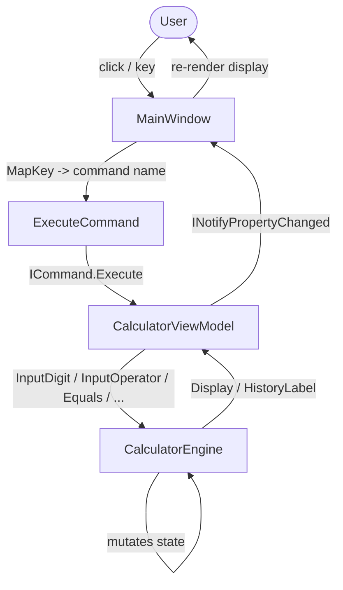

# Architecture

The system is a thin MVVM stack over a pure logic core. Input enters at the
`MainWindow` (a button click or a key press), is translated into a command
name, executed against the `CalculatorViewModel`, which in turn calls the
`CalculatorEngine`. The engine mutates its own state and exposes the result
through two bound properties (`Display`, `HistoryLabel`). Because the engine
holds **all** calculator state and has no WPF dependency, the entire
arithmetic/state-machine behaviour is verifiable without instantiating any UI.

Data enters only via the engine's public input methods (`InputDigit`,
`InputOperator`, `Equals`, etc.) and exits only via the two display strings.
There is no file, network, or database I/O anywhere in the project.

## Components

- **`CalculatorEngine`** — the state machine. Owns `_display`, the pending
  operand/operator, the repeat-`=` memory, and the error flag. See
  [`modules/engine.md`](modules/engine.md).
- **`CalculatorViewModel`** — constructs one `RelayCommand` per button and
  wires it to an engine call followed by a `Refresh()`. See
  [`modules/view-model.md`](modules/view-model.md).
- **`RelayCommand` / `ViewModelBase`** — the MVVM plumbing (`ICommand`,
  `INotifyPropertyChanged`). See [`modules/commands.md`](modules/commands.md).
- **`MainWindow`** — the visual tree and the keyboard mapping that reuses the
  same commands. See [`modules/ui.md`](modules/ui.md).
- **`Calculator.Tests`** — xUnit suite asserting on the view model. See
  [`modules/tests.md`](modules/tests.md).

## System Diagram

## Data Flow

1. **Input** — a button raises its bound command, or `OnPreviewKeyDown`
   maps a `Key` to a command name and executes it
   ([`MainWindow.xaml.cs:MapKey`](https://github.com/djgene01/Calculator/blob/42654e2af49a04a83557b51b7d94450987af8cd0/Calculator/MainWindow.xaml.cs#L28)).
2. **Dispatch** — the `RelayCommand` runs its lambda, which calls the matching
   engine method
   ([`CalculatorViewModel.cs`](https://github.com/djgene01/Calculator/blob/42654e2af49a04a83557b51b7d94450987af8cd0/Calculator/CalculatorViewModel.cs#L16)).
3. **Compute** — the engine updates its state and, where relevant, resolves a
   pending operation via `TryCompute`
   ([`CalculatorEngine.cs:TryCompute`](https://github.com/djgene01/Calculator/blob/42654e2af49a04a83557b51b7d94450987af8cd0/Calculator/CalculatorEngine.cs#L222)).
4. **Publish** — `Refresh()` copies `engine.Display`/`engine.HistoryLabel` into
   the view model properties, which fire `PropertyChanged`
   ([`CalculatorViewModel.cs:Refresh`](https://github.com/djgene01/Calculator/blob/42654e2af49a04a83557b51b7d94450987af8cd0/Calculator/CalculatorViewModel.cs#L77)).
5. **Render** — the XAML `TextBlock`s bound `OneWay` to those properties update.

## Key Design Decisions

- **Engine has zero WPF references** — it lives in the `Calculator` assembly
  but only uses the BCL, so it could be extracted to a class library unchanged.
- **One command per button; keyboard reuses them** — `ExecuteCommand` looks the
  command up by name string, so a key press and a button click are
  indistinguishable to the engine. This is what makes the digit-capture and
  repeat-state logic testable through the public command surface alone.
- **Repeat-`=` memory is disarmed by any fresh operand entry** — every
  operand-entry path calls `ResetRepeatState()`, so a stale repeat can never
  leak into a new calculation.
- **Errors are a sticky state, not exceptions** — `SetError()` latches
  `_hasError`; all input methods early-return while it's set, and only `Clear`
  (or `ClearEntry`) recovers. This keeps the UI simple: the display just shows
  the string `"Error"`.
