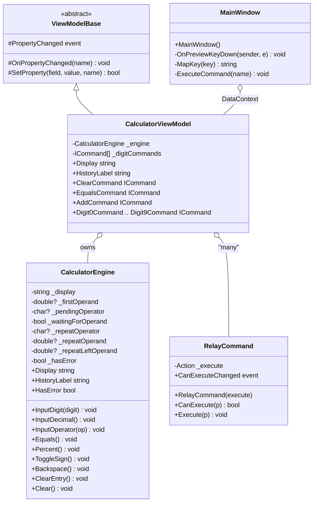

# Class Diagram

The object graph is small and linear: a `MainWindow` hosts a
`CalculatorViewModel`, which owns a `CalculatorEngine` and a set of
`RelayCommand`s. `ViewModelBase` supplies change-notification.

## Notes

- **`ICommand` is the seam.** Both `MainWindow` (keyboard) and the XAML
  (buttons) hold references to the same `RelayCommand` instances owned by the
  view model — there is no second command path.
- **`CommandManager.RequerySuggested`** is how `RelayCommand.CanExecuteChanged`
  is raised; it requires a live WPF `Application`, which is why the test project
  keeps one alive.
- The engine's private fields are the complete calculator state; no state
  lives in the view model or the window.
