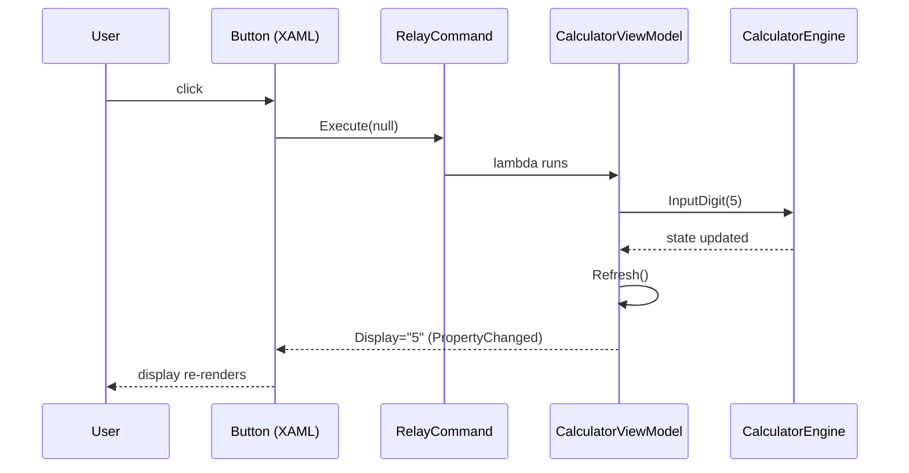
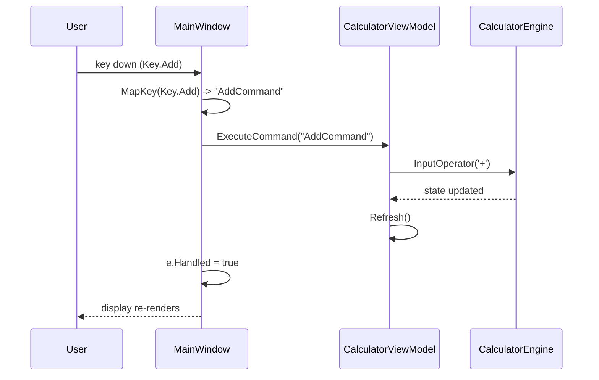
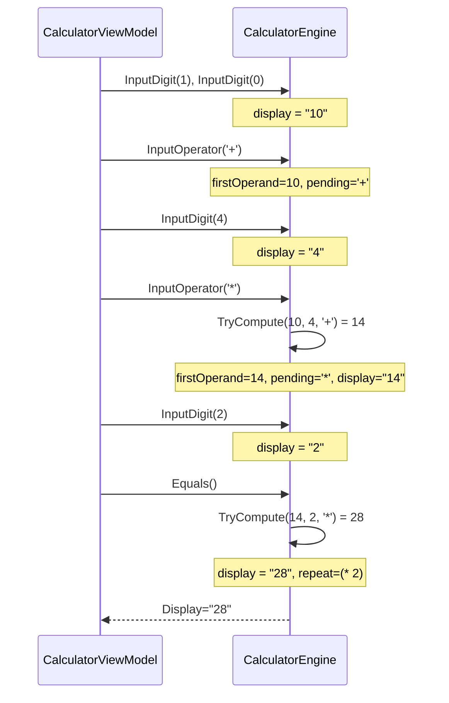

# Sequence Diagrams

## Workflow: Button click (e.g. press `5`)

The common path for a mouse click on a digit button.

### Walkthrough

1. **Click** — the bound `Button` invokes its `Command`
   ([`MainWindow.xaml`](https://github.com/djgene01/Calculator/blob/42654e2af49a04a83557b51b7d94450987af8cd0/Calculator/MainWindow.xaml#L154)).
2. **Execute** — `RelayCommand.Execute` runs the stored lambda
   ([`RelayCommand.cs:Execute`](https://github.com/djgene01/Calculator/blob/42654e2af49a04a83557b51b7d94450987af8cd0/Calculator/RelayCommand.cs#L19)).
3. **Engine call** — the lambda calls `InputDigit(5)`
   ([`CalculatorViewModel.cs`](https://github.com/djgene01/Calculator/blob/42654e2af49a04a83557b51b7d94450987af8cd0/Calculator/CalculatorViewModel.cs#L32)).
4. **Refresh** — copies `Display`/`HistoryLabel` to bound properties
   ([`CalculatorViewModel.cs:Refresh`](https://github.com/djgene01/Calculator/blob/42654e2af49a04a83557b51b7d94450987af8cd0/Calculator/CalculatorViewModel.cs#L77)).

---

## Workflow: Keyboard entry (e.g. type `+` on the numpad)

The keyboard path converges onto the same commands as the buttons.

### Walkthrough

1. **Key down** — `PreviewKeyDown` handler fires
   ([`MainWindow.xaml.cs:OnPreviewKeyDown`](https://github.com/djgene01/Calculator/blob/42654e2af49a04a83557b51b7d94450987af8cd0/Calculator/MainWindow.xaml.cs#L19)).
2. **Map** — `MapKey` translates the `Key` enum to a command name; numpad `+`
   is `Key.Add`
   ([`MainWindow.xaml.cs:MapKey`](https://github.com/djgene01/Calculator/blob/42654e2af49a04a83557b51b7d94450987af8cd0/Calculator/MainWindow.xaml.cs#L28)).
3. **Dispatch** — `ExecuteCommand` looks the command up on the view model and
   executes it, then marks the key handled.

---

## Workflow: Immediate-execution chain (`10 + 4 × 2 =`)

Shows how chaining resolves operations left-to-right as operators arrive.

### Walkthrough

1. **Chain at `*`** — `InputOperator` sees a non-waiting entry, so it computes
   the pending `10 + 4` first, then stores the new operator
   ([`CalculatorEngine.cs:InputOperator`](https://github.com/djgene01/Calculator/blob/42654e2af49a04a83557b51b7d94450987af8cd0/Calculator/CalculatorEngine.cs#L112)).
2. **`Equals`** — resolves `14 * 2 = 28` and records the repeat
   ([`CalculatorEngine.cs:Equals`](https://github.com/djgene01/Calculator/blob/42654e2af49a04a83557b51b7d94450987af8cd0/Calculator/CalculatorEngine.cs#L139)).
3. **Result** — the display shows `28` (not `10 + 8 = 18`); this is the
   immediate-execution semantics asserted by `ChainedOperationsResolveLeftToRight`.
